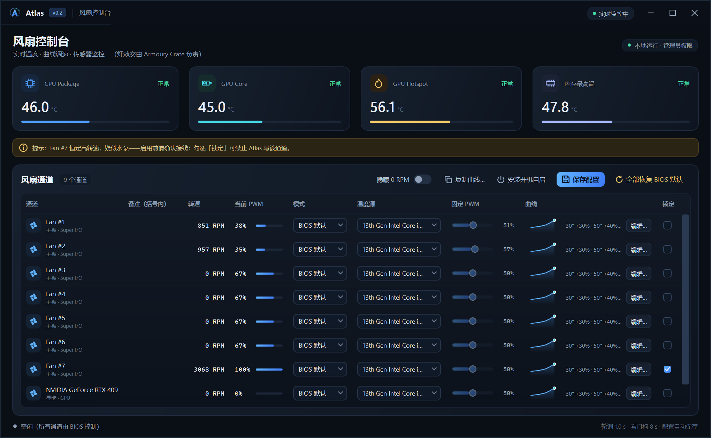
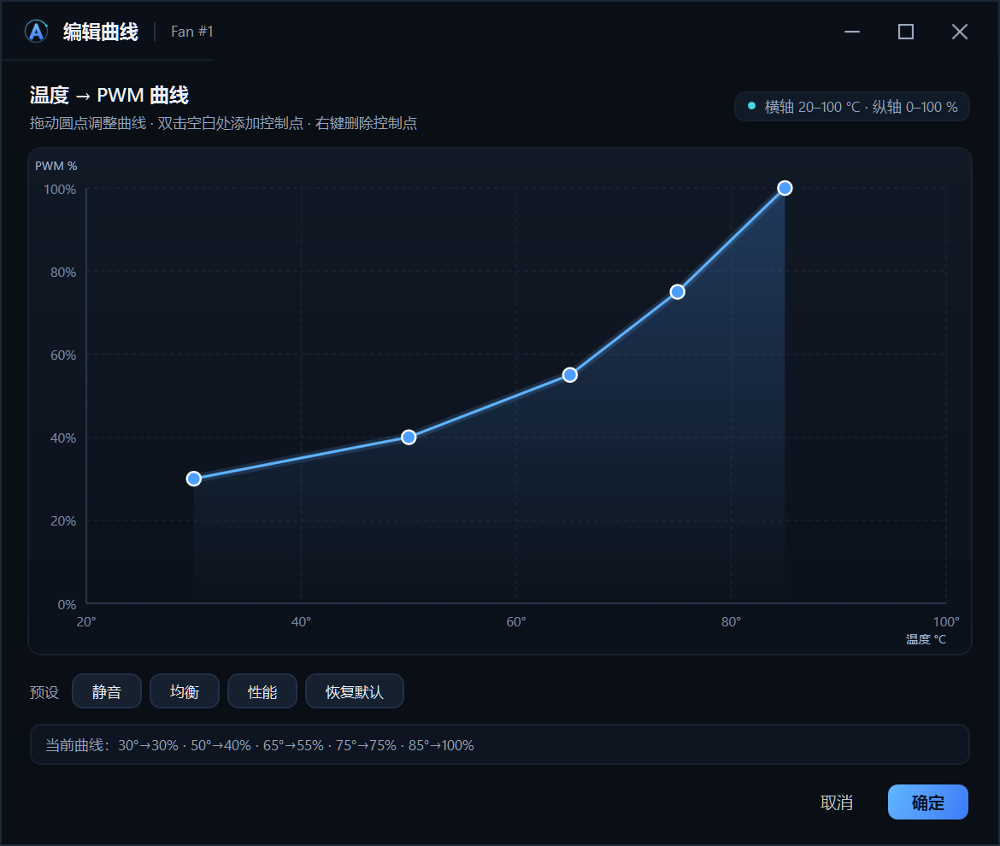
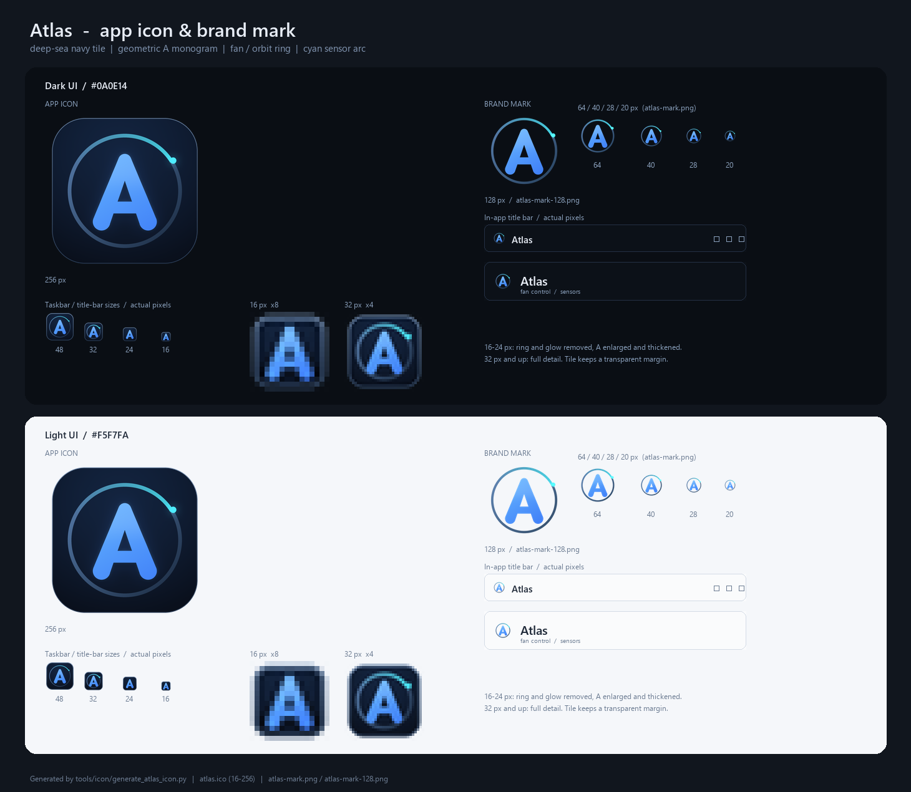

# Atlas

Windows PC 一体化硬件控制软件——**自用个人版：风扇控制 + 传感器监控**。灯效交给 Armoury Crate，Atlas 不碰灯。

当前状态：**v0.2 可用**（三种模式：BIOS 默认 / 固定 PWM / 温度曲线；曲线编辑器；通道锁定；看门狗；开机自启）。

## 快速开始

> 本仓库只托管源码与文档。`dist/`、`app/`、`artifacts/`、`.preview/` 都是本地构建 / 预览产物，未纳入版本管理；克隆后请先按「重新编译 / 打包」构建。

**直接启动**（已编译好 Release 版）：

```powershell
# 双击 dist\Atlas.exe（会弹 UAC），或运行：
run-atlas.cmd
```

**重新编译 / 打包**（需要 .NET 8 SDK；先关闭正在运行的 Atlas）：

```powershell
.\build.ps1                        # 框架依赖构建到 dist\（双击 build.cmd 也可以）
.\build.ps1 -Mode SingleFile -Zip  # 免运行时的单文件 exe，并打包成 artifacts\*.zip
```

> `build.ps1` 会自动检查 SDK、清理旧输出、检查 Atlas 是否占用文件。完整参数见[构建与打包](#构建与打包)。

前置依赖：

- 已安装 **PawnIO 2.2.0**（https://pawnio.eu，LHM/FanControl/OpenRGB 的标准依赖）
- 程序目录需加入 Windows Defender 排除（系统启用了 ASR「阻止不受信任的可执行文件」）；当前 `D:\Github\Atlas` 已在排除列表
- 风扇控制不要和 FanControl / Fan Xpert / Armoury Crate 的风扇功能同时运行（同一 SuperIO 只能有一个写者）

## 界面与图标

深色仪表盘界面：自定义标题栏、温度卡片（实时数值 / 状态 / 进度条）、通道表格（曲线缩略图、PWM 迷你条、深色下拉与滑块），以及同风格的温度曲线编辑器和批量复制对话框。





应用图标为**深海蓝圆角底板 + 几何 "A" 字标 + 轨道环**（环上青色弧线与传感器圆点），16–256px 共 10 帧，用于 exe、任务栏、窗口标题栏与程序内品牌位；16/24px 单独简化过，深色、浅色任务栏下都能辨认。



图标与品牌素材在 `src/Atlas.App/Assets/` 和 `docs/branding/`，可用 `tools/icon/generate_atlas_icon.py` 重新生成。

## 构建与打包

`build.ps1` 是一键构建脚本，`build.cmd` 是双击用的包装器（参数完全相同，Windows PowerShell 5.1 即可运行）。

| 命令 | 产物 |
| --- | --- |
| `.\build.ps1` | 框架依赖 → `dist\`（体积最小，目标机需 .NET 8 Desktop Runtime） |
| `.\build.ps1 -Mode SelfContained` | 自包含目录 → `dist\`（目标机免装运行时，体积较大） |
| `.\build.ps1 -Mode SingleFile` | 自包含单文件 → `dist\Atlas.exe`（免装运行时，单文件） |
| `.\build.ps1 -Mode SingleFile -Zip` | 同上，并在 `artifacts\` 生成 zip 压缩包 |
| `.\build.ps1 -Output D:\Temp\atlas` | 发布到其他目录 |
| `.\build.ps1 -StopAtlas` | 构建前尝试结束正在运行的 Atlas（需管理员权限的终端） |
| `.\build.ps1 -NoClean` | 不先清空输出目录（增量发布） |

说明：

- **构建前先关闭 Atlas**：`dist\` 里的 `Atlas.dll` / `Atlas.exe` 被运行时占用，发布会失败。不想手动关可以试 `-StopAtlas`，但普通窗口通常结束不了提权进程，建议手动关闭窗口后再构建。
- 输出目录（默认 `dist\`）默认会整个清空后重新发布；**用户配置在 `%LocalAppData%\Atlas\config.json`，不受影响**。
- `-Zip` 的压缩包在 `artifacts\Atlas-v<版本>-win-x64-<模式>.zip`，zip 内直接是 `Atlas.exe` 等文件，解压即用。
- 其他参数：`-Configuration Release|Debug`（默认 Release）、`-Runtime win-x64`（默认）。
- 需要 .NET 8 SDK（本机为 8.0.427）；只有 `Framework` 模式的目标机才需要额外安装 .NET 8 Desktop Runtime。
- 直接使用 `dotnet publish` 也可以，等效命令：
  `dotnet publish src\Atlas.App\Atlas.App.csproj -c Release -r win-x64 --self-contained false -o dist`

## 项目结构

```
src/Atlas.Core/   硬件层（LibreHardwareMonitor 封装 + 风扇控制引擎 + 配置）
src/Atlas.Cli/    命令行冒烟测试（list / smoke）
src/Atlas.App/    WPF 界面（管理员权限）；Assets/ 里是图标与品牌素材
build.ps1         一键构建 / 打包脚本（build.cmd 为双击包装器）
app/              部署目录（构建产物复制到这里）
tools/            开发期硬件探测工具（SensorProbe / FanProbe）；tools/icon/ 为图标生成脚本
docs/             评估报告、个人版开发计划；docs/branding/ 为图标与界面截图
research/         软硬件生态调研笔记
```

## 文档

- [个人版开发计划与当前状态](docs/personal-build-plan.md)：本机硬件、Phase 0 实测结果、v0.2 功能、安全设计、后续版本
- [可行性评估报告](docs/feasibility-assessment.md)：分模块结论、竞品事实、推荐架构、工作量、风险
- [生态调研笔记](research/rgb-landscape.md)：SignalRGB / Armoury Crate / OpenRGB 现状与开源属性
- [底层访问调研笔记](research/windows-hardware-access.md)：驱动签名、WinRing0 封禁、PawnIO、厂商 SDK
- [OpenRGB 设备兼容性](research/openrgb-device-support.md)：本机 5 类灯效设备核查（供参考，已决定灯效交给 Armoury Crate）

## 说明

- 本仓库是个人自用工具，不做商业分发，不追求全设备兼容。
- 硬件底层操作有风险；当前只对 ASUS ROG STRIX Z790-H（NCT6798D）做过实机验证。
- 关闭 Atlas 或触发看门狗时会自动把风扇交还 BIOS；开机自启会创建计划任务 `AtlasFan`（登录时以最高权限运行）。

## 许可证

[MIT](LICENSE) © 2026 hitzhangjie。欢迎参考、复用；硬件底层操作风险自负。
